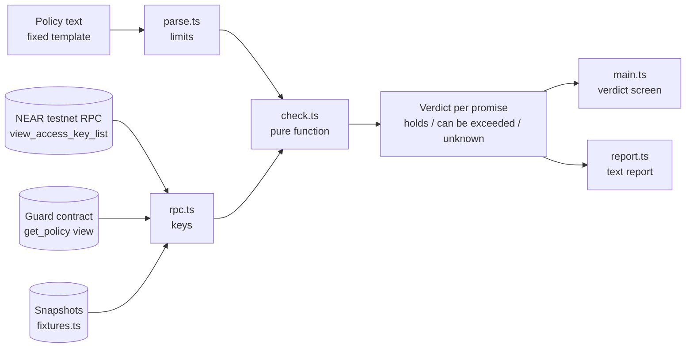

# KeyProof

Write your AI agent's spending policy in plain English. KeyProof reads the agent's NEAR access keys and proves whether the agent can exceed that policy. Pair it with the guard contract and the limits are enforced on chain, not only reported.

Prompts are not permissions. The check happens on the chain, not in the prompt.

Built for the NEAR Hackathon, track 06: AI Security & Defense.

## Who it is for

- Teams giving an agent a wallet.
- The ops person who authorises it.
- The auditor who has to sign off.

## Setup

```bash
cd keyproof
npm install
npm run dev
```

Open the URL Vite prints (http://localhost:5173). The example policy is already checked against a recorded snapshot, so you see a failing verdict before typing anything.

Requires Node 18 or newer. The checker needs no wallet, no private key and no account.

No install at all: open `standalone/keyproof.html` in a browser. It is the same app as one file, with snapshots and live mode.

## What the checks mean on NEAR

A function call key cannot transfer NEAR or attach a deposit. Its allowance is the most NEAR it can spend on gas. KeyProof compares that allowance with your limit, and flags keys with no allowance (unlimited gas), keys that can call any method, and receivers that are not on your allowlist. It also flags full access keys, which can move funds directly. See the [NEAR access key docs](https://docs.near.org/protocol/access-keys).

The attack animation on the landing page illustrates keys going past a policy. It is not a transaction. The example account `agent-ops.testnet` is a recorded fixture. KeyProof does not read gas keys (NEP-611) specially, so they may show as unknown. It checks key permissions, not whether the policy itself is sensible.

## How it works



1. **Parse.** The policy becomes machine limits. Any line that does not match the template is rejected, never skipped, because a skipped rule would read as a pass.
2. **Read.** The agent's keys come from the `view_access_key_list` RPC query: permission, allowance, receiver and method scope. If the policy names a guard, its `get_policy` view is read too.
3. **Verdict.** Each promise gets `holds`, `can be exceeded` or `unknown`, with one sentence and the exact field that decides it.

### Policy template

```
Account: agent-ops.testnet
The agent may spend up to 5 NEAR per day.
The agent may only call these contracts: wrap.testnet, v2.ref-finance.testnet
The agent must not hold a full access key.
The agent may only call named methods.
```

### Findings

| Finding | Field | Promise it breaks |
| --- | --- | --- |
| Allowance above the limit | `allowance` | Allowance limit |
| Allowance with no cap at all | `allowance = null` | Allowance limit |
| Key with full access | `permission = "FullAccess"` | Limit, allowlist, no full access |
| Key can call any method | `method_names = []` | Named methods only |
| Key receiver not on the allowlist | `receiver_id` | Contract allowlist |
| Guard cap above your limit | `guard.daily_cap` | Guard spend cap |
| Guard can pay an unlisted account | `guard.pay_to` | Guard recipients |
| Agent owns its own guard | `guard.owner` | Guard control |

## Why a guard

A NEAR function call key can limit the contract it calls, the methods, and a total gas allowance. It cannot limit how much is paid out per day, or to whom. The guard contract does: a daily cap and a recipient allowlist that hold across calls.

Related work: ERC-7715 (MetaMask Advanced Permissions) defines fixed and periodic allowances, expiry and a human-readable justification for EVM wallets. The guard's cap is a periodic allowance that resets each UTC day. KeyProof adds the verification: it checks that the agent's keys and the guard both match the policy a human wrote.

## Guard: verify and enforce

KeyProof on its own reports. The guard contract in `contracts/guard` enforces.

- The owner (a human) funds a guard contract with a daily cap and a recipient allowlist.
- The agent's account holds one function call key that can only call `spend` on the guard.
- `spend` pays only allowlisted accounts and only up to the cap per UTC day. A breaking call reverts and no NEAR moves.
- Only the owner can change the policy.
- KeyProof checks both halves: the agent's keys reach only the guard, and the guard's cap, recipients and owner match the policy.

Extra policy sentences:

```
The guard kp-guard.testnet caps spending at 2 NEAR per day.
The guard kp-guard.testnet may only pay these accounts: kp-owner.testnet
```

Try it: press "Guard example" in the checker. To deploy a real guard on testnet and run four attacks against it:

```bash
bash scripts/guard-demo.sh
```

The script creates three throwaway testnet accounts (guard, agent, owner), builds and deploys the contract, restricts the agent to one key, and tries four attacks signed with that key. The first run installs Rust and takes a while.

The guard is testnet only and not audited. It only protects the money the guard itself holds.

## Scope

In scope:

- Text policy from a fixed template, plus optional guard rules.
- NEAR testnet agent accounts.
- Key inspection and guard inspection over RPC (view calls only).
- The verdict screen and a downloadable text report.
- A small guard contract and a script that deploys and attacks it.

The checker is read only. Nothing is signed and no keys are requested. The guard is a separate contract you deploy yourself.

## What we cut and why

| Cut | Why |
| --- | --- |
| Mainnet funds | Real money needs an audit. The guard is unaudited, so testnet only. |
| Cross-chain intents | The policy language would have to cover chains we cannot read keys from in two weeks. |
| History of key changes | Needs an indexer. The point in time check is the product. |
| Alerts | Needs a server and a trust model for who gets paged. |
| Teams and accounts | A login would contradict "no keys requested". |
| A contract inside the checker | The checker stays view-only. The guard is a separate, optional contract. |
| Natural language policy parsing with an LLM | A model that guesses at the policy would put a prompt back inside the thing that says prompts are not permissions. The fixed template is deliberate. |
| Per-day measurement of key allowances | An allowance is a total, not a per-day rate. The guard enforces a per-day cap instead. |
| Guard features beyond cap and allowlist | Per-token limits, approvals and multiple agents would add attack surface. v1 keeps it small. |

## Try it on a real testnet account

1. Create a testnet account and add keys with different permissions: a function call key with a small allowance and named methods, one with a large allowance, and keep the full access key it started with.
2. Put the account id on the first line of the policy.
3. Choose "Live testnet" as the key source and press Check keys.
4. Remove or tighten the offending keys and check again. The verdict turns green.

`scripts/live-demo.sh` automates steps 1 and 4: `bash scripts/live-demo.sh` creates the account, `bash scripts/live-demo.sh fix` removes the risky keys. To use another RPC endpoint, copy `.env.example` to `.env` and set `VITE_NEAR_RPC`.

## Project layout

```
src/
  parse.ts      policy template to limits
  check.ts      pure function: policy + keys + guard -> verdicts
  rpc.ts        read-only RPC: access keys and the guard's get_policy
  fixtures.ts   recorded before/after snapshots
  report.ts     text report and download
  main.ts       verdict screen
  sim.ts        landing page attack illustration
  units.ts      yoctoNEAR helpers
contracts/guard/   the guard contract (Rust, near-sdk)
scripts/guard-demo.sh   deploy the guard and run four attacks
standalone/     the same app as a single HTML file
docs/DEMO.md    demo script and X post draft
```

Commands: `npm run dev`, `npm run build`, `npm run typecheck`.

## Limitations

- Snapshots are fixtures for fictional accounts, labelled as such in the app.
- Live mode depends on the public testnet RPC being reachable and allowing browser requests.
- KeyProof reads access keys and the guard's policy only. It does not read other contract-level rules.
- The guard has not been audited, and its tests have not yet been run in CI.

## License

MIT
