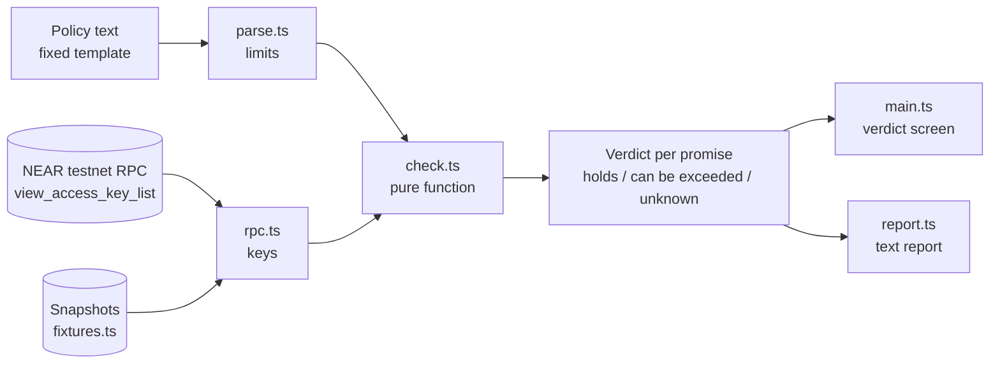

# KeyProof

Write your AI agent's spending policy in plain English. KeyProof reads the agent's NEAR access keys and proves whether the agent can actually exceed that policy.

Prompts are not permissions. The check happens on the chain, not in the prompt.

Built for the NEAR Hackathon, track 06: AI Security and Defense.
## What the checks mean on NEAR

A function call key cannot transfer NEAR or attach a deposit. Its allowance is the most NEAR it can spend on gas. KeyProof compares that allowance with your limit, and flags keys with no allowance (unlimited gas), keys that can call any method, and receivers that are not on your allowlist. It also flags full access keys, which can move funds directly.

The attack animation on the landing page illustrates keys going past a policy. It is not a transaction. The example account `agent-ops.testnet` is a recorded fixture. KeyProof does not read gas keys (NEP-611) specially, so they may show as unknown. It checks key permissions, not whether the policy itself is sensible.


## Who it is for

- Teams giving an agent a wallet.
- The ops person who authorises it.
- The auditor who has to sign off.

## Setup

```bash
cd keyproof
npm install
npm run dev
```

Open the URL Vite prints (http://localhost:5173). The example policy is already checked against a recorded snapshot, so you see a failing verdict before typing anything.

Requires Node 18 or newer. No wallet, no private key and no account are needed.

No install at all: open `standalone/keyproof.html` in a browser. It is the same app as one file, with snapshots and live mode.

## How it works



1. **Parse.** The policy becomes machine limits: a daily cap, an allowlist of contracts, and two yes/no rules. Any line that does not match the template is rejected, never skipped. A skipped promise would show as "holds", which is the worst failure for a verification tool.
2. **Read.** The agent's keys come from the `view_access_key_list` RPC query. For each key: permission type, allowance, receiver and method scope.
3. **Verdict.** Each promise gets `holds`, `can be exceeded` or `unknown`. Every finding is one sentence, then the key field that causes it, then the policy sentence it breaks.

### Policy template

```
Account: agent-ops.testnet
The agent may spend up to 5 NEAR per day.
The agent may only call these contracts: wrap.testnet, v2.ref-finance.testnet
The agent must not hold a full access key.
The agent may only call named methods.
```

### Findings in v1

| Finding | Key field | Promise it breaks |
| --- | --- | --- |
| Allowance above the daily cap | `allowance` | Daily spend cap |
| Allowance with no cap at all | `allowance = null` | Daily spend cap |
| Key with full access | `permission = "FullAccess"` | Cap, allowlist, no full access |
| Key can call any method | `method_names = []` | Named methods only |
| Key receiver not on the allowlist | `receiver_id` | Contract allowlist |

### What "allowance" means here

On NEAR, a function call key's allowance bounds the gas fees the key may burn. Function call keys cannot attach a deposit. So the allowance is the one on-chain spend limit such a key carries, and it is the field compared with the daily cap. A full access key has no limit at all.

Check this against the [NEAR access key docs](https://docs.near.org/protocol/access-keys) before relying on it for a real deployment.

### The honest footnote

KeyProof verifies key permissions, not whether the policy itself is sensible. A policy that allows the agent to drain a pool will be verified as correctly enforced.

## Scope

In scope:

- Text policy from a fixed template.
- A NEAR testnet agent account.
- Key inspection over RPC (view calls only).
- The verdict screen.
- A downloadable text report.

Read only. Nothing is signed. No keys are requested. There is no backend and no deployed contract, so there is very little that can break.

## What we cut and why

| Cut | Why |
| --- | --- |
| Mainnet funds | A verifier that touches real money needs an audit. A read-only testnet tool does not. |
| Cross-chain intents | The policy language would have to cover chains we cannot read keys from in two weeks. |
| History of key changes | Needs an indexer. The point in time check is the product. |
| Alerts | Needs a server and a trust model for who gets paged. |
| Teams and accounts | A login would contradict "no keys requested". |
| Anything needing a contract we deploy | Every deployed contract is more attack surface. v1 uses view calls only. |
| Natural language policy parsing with an LLM | A model that guesses at the policy would put a prompt back inside the thing that says prompts are not permissions. The fixed template is deliberate. |
| Per-day enforcement | An allowance is a total, not a per-day rate. KeyProof flags allowances above the cap and does not claim to measure velocity. |

## Try it on a real testnet account

1. Create a testnet account and add keys with different permissions: one function call key with a small allowance and named methods, one with a large allowance, one full access key. See the [NEAR docs](https://docs.near.org/) for key management with the CLI.
2. Put the account id on the first line of the policy.
3. Choose "Live, NEAR testnet" as the key source and press Check keys.
4. Remove or tighten the offending keys and check again. The verdict turns green.

To use another RPC endpoint, copy `.env.example` to `.env` and set `VITE_NEAR_RPC`.

## Project layout

```
src/
  parse.ts      policy template to limits
  check.ts      pure function: policy + keys -> verdicts
  rpc.ts        read-only view_access_key_list
  fixtures.ts   recorded before/after snapshots
  report.ts     text report and download
  main.ts       verdict screen
  units.ts      yoctoNEAR helpers
standalone/     the same app as a single HTML file
docs/DEMO.md    75 second demo script and X post draft
```

Commands: `npm run dev`, `npm run build`, `npm run typecheck`.

## Limitations

- Snapshots are fixtures for a fictional account, labelled as such in the app.
- Live mode depends on the public testnet RPC being reachable and allowing browser requests.
- KeyProof reads access keys only. It does not read contract-level permissions inside the contracts the keys can call.

## License

MIT
